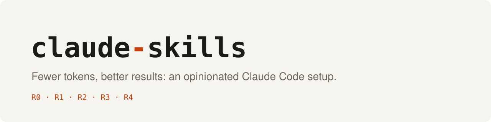
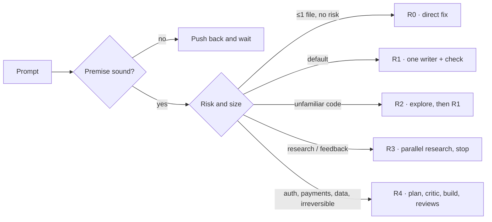

<div align="center">

<picture>
  <source media="(prefers-color-scheme: dark)" srcset="docs/assets/banner-dark.svg">
  
</picture>

[](LICENSE)
[](https://code.claude.com/docs)

[Install](#install) · [Skills](#skills) · [How routing works](#how-routing-works) · [Third-party](THIRD_PARTY.md)

</div>

The Claude Code configuration I actually use, with personal paths removed. It is built around one idea: **don't run the same heavy process on every task.** A single writer plus an executable check is the default; the full plan, critique and review cycle is kept for risky work.

## What you get

- **Task routing (R0–R4).** A hook reads each build or improve prompt and reminds the model to pick a route sized to the task and its risk, from a direct fix up to a full plan/critic/review cycle.
- **A UI design council.** On site, app or interface prompts, the same hook asks the model to have your design skills each propose and critique once before any UI code is written, then merge the best ideas.
- **Six skills of my own**, including `readme-design`, which wrote this README.
- **Six pinned subagents** (`explorer`, `researcher`, `implementer`, `planner`, `critic`, `reviewer`) with fixed model and effort, replying in a short fixed template to save tokens.
- **Safety rails.** A gate that blocks installing skills or plugins until they were scanned, and a sync script that refuses to commit secrets or personal data.
- **Zero-token audits.** Scripts that measure your always-loaded context cost and lint your `.claude` folder offline.

## Skills

<!-- SKILLS_TABLE_START -->
| Skill | Purpose |
|---|---|
| `big-task-workflow` | Use whenever the user asks to build or improve something (site, app, feature, integration, refactor, restructuring) or to investigate a complex system (e.g. ... |
| `feature-assessment` | Use BEFORE building or changing something non-trivial (routes R2-R4 of big-task-workflow, or when the user asks for a verdict); in route R1 give only a one-l... |
| `humanize-loop` | Use when the user wants prose to read less like AI output and wants it measured, e.g. "humanize and test this", "run it through AI detectors", "get the AI sc... |
| `project-map` | Use when the user asks to explain, understand, map, or get an overview of a project or codebase ("explain this project", "how does this repo work", "map the ... |
| `readme-design` | Write or redesign a GitHub README that sells the project in the first screen — hero with logo/banner, real screenshots or GIF demo captured from the running ... |
| `repo-howto` | Use when the user wants to know how EXTERNAL open-source projects do something, or says "find GitHub repos that do X", "has someone built this", or pastes a ... |
<!-- SKILLS_TABLE_END -->

Skills written by other people are **not copied here**; they are linked in [THIRD_PARTY.md](THIRD_PARTY.md).

## How routing works



## Install

Everything is plain files. Back up your own `~/.claude` first, then:

1. Copy what you want: `skills/*` → `~/.claude/skills/`, `agents/*.md` → `~/.claude/agents/`, `hooks/*` → `~/.claude/hooks/`, `scripts/*` → `~/.claude/scripts/`.
2. Merge `examples/settings.example.json` into `~/.claude/settings.json` (don't overwrite yours) and replace `<HOME>` with your home folder. The hooks need Node.js.
3. Check the cost:

```bash
node ~/.claude/scripts/context-audit.mjs
```

```bash
node ~/.claude/scripts/config-audit.mjs
```

> [!WARNING]
> **Windows only as shipped:** the settings example runs `skill-install-gate.ps1` through PowerShell. On macOS or Linux remove those two hook entries or port the gate, otherwise every Bash call errors.

<details>
<summary><b>More before you copy</b></summary>

- Copy `scripts/` together with `hooks/`: `hooks/plugin-hook.mjs` imports `scripts/plugin-toggle.mjs`.
- `plugin-hook.mjs` (`TRIGGERS`) and `plugin-toggle.mjs` (`GROUPS`) list the plugins I toggle; edit both to match yours.
- The UI design council in `build-prompt-nudge.mjs` names skills I have installed (`hallmark`, `frontend-design`, `ui-ux-pro-max`, Emil Kowalski's pack). Swap in your own or the model will skip the missing ones.
- `examples/CLAUDE.global.example.md` is my own policy (git rules, routes, risk list). Read it before adopting it.
- The example does not set `CLAUDE_CODE_SUBAGENT_MODEL`: each agent file pins its own model.

</details>

## What's inside

| Folder | Content |
|---|---|
| `skills/` | The skills above |
| `agents/` | Six subagents with pinned model and effort |
| `hooks/` | `build-prompt-nudge.mjs` (routes + UI council), `compact-nudge.mjs` (suggests `/compact` after many tool calls), `plugin-hook.mjs` (turns on-demand plugins on), `skill-install-gate.ps1` (blocks unscanned installs) |
| `scripts/` | `context-audit.mjs`, `config-audit.mjs`, `plugin-toggle.mjs`, `sync-readme.mjs` (maintains this repo) |
| `examples/` | `CLAUDE.global.example.md` and `settings.example.json` |

## Security notes

- Hooks run code on your machine; read each one before enabling it. These use no network and no `eval`; `config-audit.mjs` checks your folder for both.
- A hook cannot load a plugin into a running session: `plugin-hook.mjs` only edits `settings.json`, you still run `/reload-plugins`.
- `skill-install-gate.ps1` matches command text. It can block a harmless command that only mentions an install, and it fails open when it can't parse its input. It's a seat belt, not a guarantee.
- Hooks inject reminders; they can't force the model to call a skill.
- The routes are a hypothesis built from published evidence, not a proven benchmark result. Treat them as a starting point.

## Maintenance

`scripts/sync-readme.mjs` mirrors only the skills authored here, refreshes the skills table, refuses to commit if it finds secrets or personal data, and never pushes.

## License

MIT, see [LICENSE](LICENSE). Third-party skills linked from [THIRD_PARTY.md](THIRD_PARTY.md) keep their own licenses.
