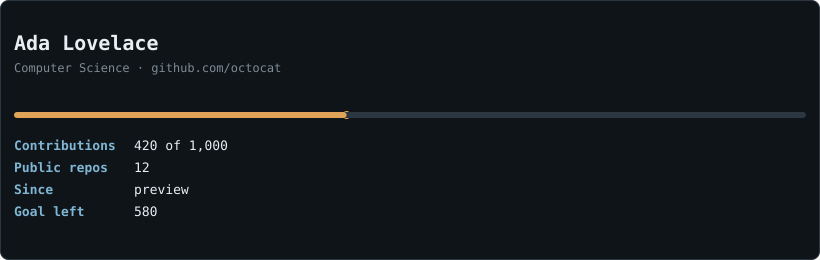

# github-profile-readme

A Claude Code skill that audits a GitHub profile and builds or revamps its `username/username` README: which repos to pin, an honest progress card refreshed daily by a GitHub Action, project cards with real screenshots, grouped stack badges and contact buttons.

<p align="center">
  <picture>
    <source media="(prefers-color-scheme: light)" srcset="docs/assets/card-example-light.svg">
    
  </picture>
  <br><sub>Sample card with made-up data (generated by <code>scripts/render_card.py</code>).</sub>
</p>

## Why use it

Recruiters and reviewers spend a couple of minutes on a profile. What carries weight is a few pinned repos, each with a README that says why it exists and how to run it, plus a screenshot or demo. The contribution graph counts for less, and decoration (visitor counters, GIF walls, emoji soup) hurts. The skill encodes that:

- **Audit first.** Read-only listing of repos (size, last push, README present), a pin proposal, what to merge or archive. Repos are archived, never deleted, and you decide before anything changes.
- **Nothing invented.** No fake stars, followers, metrics or testimonials. Personal data only from what you already published.
- **Real visuals.** Screenshots captured from the running app, with a check that nothing personal leaks.
- **Cheap to maintain.** The card is plain SVG generated with the stdlib; the Action uses only the built-in `github.token` and `contents: write`.

## Install

Copy the folder into your Claude Code skills directory:

```bash
cp -r github-profile-readme ~/.claude/skills/
```

Then ask Claude something like "improve my GitHub profile" or "build my profile README".

## What is inside

| Path | Purpose |
|---|---|
| `SKILL.md` | The workflow and hard rules |
| `references/audit-checklist.md` | Pin criteria, per-repo checklist, read-only `gh` commands |
| `references/sections.md` | HTML snippets: card, 2x2 project table, badges, contact buttons |
| `references/card-and-actions.md` | How the card and the daily workflow are built |
| `references/pitfalls.md` | Mistakes that already happened |
| `scripts/render_card.py` | Dark and light SVG card, stdlib only |
| `scripts/profile.yml.template` | Daily workflow (commit, rebase, push) |
| `scripts/make_ascii_art.py` | Optional ASCII picture for the card (Pillow + numpy) |

## Try the card locally

```bash
python scripts/render_card.py card.svg --user <you> --name "Your Name" --tagline "Your role" --contributions 420 --repos 12
```

This writes `card.svg` and `card-light.svg` with the numbers you pass. Without `--contributions` and `--repos` it reads live data from `api.github.com` and needs `GITHUB_TOKEN` in the environment.

## Notes

- The live API path of this generic script has not been run yet; the version it was derived from ran daily on the author's profile.
- For a single project's README (not a profile), use the `readme-design` skill in this repo.
- Third-party Actions you add (for example a bonsai generator) must be pinned by commit SHA after you read their code.

## License

MIT, see the repository [LICENSE](../../LICENSE).
